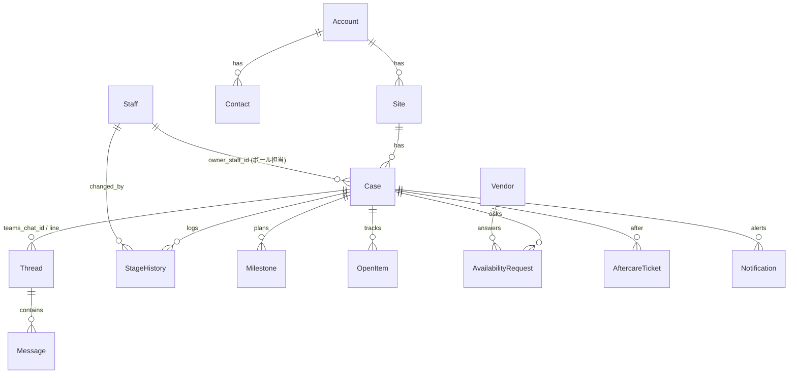

# data-model.md

型の正は `src/domain/types.ts`。ここでは関係だけを示す。

## 主なエンティティと役割

| エンティティ | 役割 | 判定に使う主なフィールド |
|---|---|---|
| Case | 案件。`lead_stage`（受注前）と `project_status`（受注後）の二層 | `owner_staff_id`, `next_action_due`, `teams_chat_id`, `andpad_order_id`, `stage_entered_at`, `rag_color`, `rag_reasons`, `red_since` |
| Thread | チャネル上の会話（Teams グループチャット 1 本 = 1 スレッド）。`case_id=null` は未割当 | `unanswered_customer_count`, `unanswered_since`, `handled_at/by/reason`, `flags` |
| Message | 外部 ID で冪等。`sender_type` は customer / staff / bot / system | `sent_at`（Graph の createdDateTime）, `direction` |
| Milestone | 計画日と実績日。`実施設計` `発注` `着工` を名前で判別 | `planned_date`, `status` |
| OpenItem | 未決事項 | `status`, `due_date` |
| AvailabilityRequest | 業者の空き確認 | `response` |
| Notification | 送った／送れなかった通知。`dedupe_key` で 1 日 1 回 | `status: sent/failed/dead`, `attempts` |
| Settings | 営業時間・祝日・閾値・段階 SLA | すべて |
| AuditLog | 誰が何をいつ変えたか | — |

## 不変条件

- `Message.external_message_id` はスレッド内で一意（同じ通知を何度受けても 1 件）。
- `Thread` の未返信状態はメッセージ列と `handled_at` から**再計算で決まる**（保存値を信じない）。
- `Case.rag_color` は `evaluateCase()` の結果のキャッシュ。1 分ごと・更新時に再計算される。
- 受注（`lead_stage=won`）と同時に `project_status=contracted` になる。失注・保留にはメモ必須。
